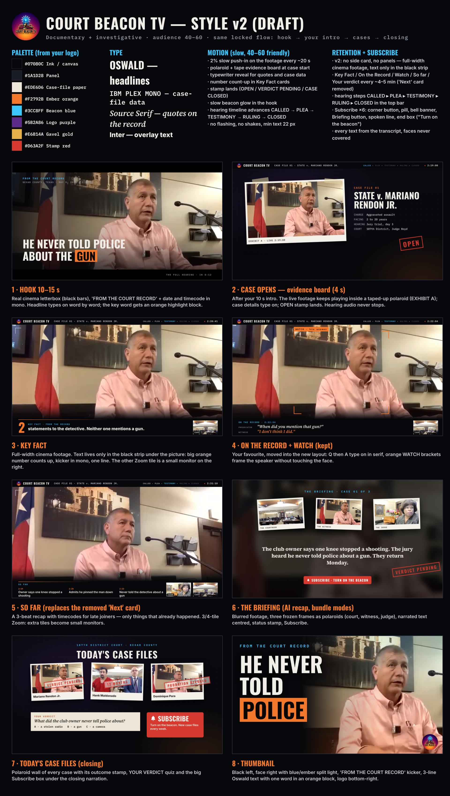

# Style pack: Court Beacon TV



Third H Labs channel. SAME locked structure as Trial Tales and Overruled (hook 10-15 s -> channel intro -> cases ->
AI recap clips <= 18 s -> closing narration, CASE START at "calling CR####"), its own look: **documentary + investigative
"cinema + evidence board"** for a 40-60 audience. Approved design: Style v2 board (Oct 2026).

Third H Labs style, next to `trial_tales` and `overruled`. Everything lives in this one folder - H Labs core
(`ucf/`, prompts, validator, other styles) is not changed. The only addition H Labs needs is an 8-line hook in
`run_stream.py` that lets a style pack ship its own renderer (`install/install.sh` adds it, with a backup).

## Install
```bash
git clone <repo-url> court_beacon
./court_beacon/install/install.sh "$HOME/Desktop/Z Labs/H Labs"
```
Then `H Labs.command` -> paste URL -> style `court_beacon` -> mode.
Windows package: copy this folder to `H Labs Windows Package/H Labs/styles/court_beacon` and add the same hook
(`install/run_stream_hook.patch`).

## Folder
```
style.json     id court_beacon, renderer "tt" (structure family) + look "cb", renderer_module engine/render_cb.py
assets/        channel_intro.mp4 (owner's 10 s animation, plays after the hook with its sound)
               logo_transparent.png (circle cut-out used in the top bar, closing board, thumbnail)
               logo_source.png (original 1254x1254 artwork)
hf/fonts/      Oswald 600/700, IBM Plex Mono 500/600, Source Serif 4 600i/700, Inter 600/800 (SIL OFL)
engine/        render_cb.py (renderer, subclass of H Labs' Overruled compose engine), cb_gfx.py (HTML/CSS graphics),
               smoke_test.py (offline render on pre-cut clips, dummy voice)
install/       install.sh + run_stream_hook.patch
docs/          approved style board
prompts/       master_v9.md + json_addendum.md + title_rules.md (Trial Tales titles) + court_beacon_extra.md
```

## Look
| Element | What it is |
|---|---|
| Canvas | top bar y 0-64 (logo, COURT BEACON TV, case label, hearing steps, ON RECORD) · cinema footage y 64-928 · bottom strip y 928-1080 |
| Hook | cinema letterbox, "FROM THE COURT RECORD", Oswald headline with one word in an orange block |
| Case open (4 s) | evidence board: the live footage keeps playing inside a taped polaroid (EXHIBIT A), case data, OPEN stamp |
| Two-shot (40+ readability) | whenever the judge's Zoom tile is on screen: person on the stand 1268x864 left, **judge 640x480 top right**, courtroom 640x372 below - both faces large. In-person hearings without a judge tile: main person full width, other tile as a monitor |
| Hearing steps | CALLED > PLEA > TESTIMONY > RULING > CLOSED in the top bar, driven by case.phases |
| Key Fact | big orange number + one line, bottom strip only |
| So Far | 2-3 recap beats, bottom strip only |
| On the Record | real Q then A in serif (video.exchanges) |
| Watch | orange corner brackets + tag around the centre of the picture (corners only, never on a face) |
| Your Verdict | comment prompt in serif |
| Briefing | (bundle modes) blurred footage + three polaroids + narrated text + Subscribe |
| Today's Case Files | closing polaroid wall with outcome stamps + quiz + big Subscribe box |
| Thumbnail | black left, face right with blue/ember light, 2-3 line Oswald text, one word in an orange block |

No "coming up" teaser cards in this look (owner decision): the renderer never draws them (the shared v10 validator
still asks the brain for one per long case, so the prompt keeps that single item but puts the effort elsewhere). Zoom 1/2/3/4 tiles: two-shot when the judge (or a second face) is on screen, otherwise the active person full width with up to two monitors in the strip. Crops follow the faces.

Palette: ink #07080C · panel #1A1D28 · paper #EDE6D6 · ember orange #F2792B · beacon blue #3CC8FF · logo purple #5B2A86
· gavel gold #E6B14A · stamp red #D63A2F.

## Tweaking
* Graphics (HTML/CSS): `engine/cb_gfx.py`. Layout, timeline, which Zoom tile is big: `engine/render_cb.py`.
* Voice, tags, intro, logo: `style.json -> config`.
* Optional: with `mediapipe` + `models/blaze_face_short_range.tflite` in H Labs the renderer makes the tile with the
  person big (in-person hearings); without it Zoom's green speaker ring decides.
* After a look change delete `output/<run>/Video_*/_work/` and `work/_cb_gfx/`, then re-render.
* Needs Playwright + Chromium (same as Overruled).
